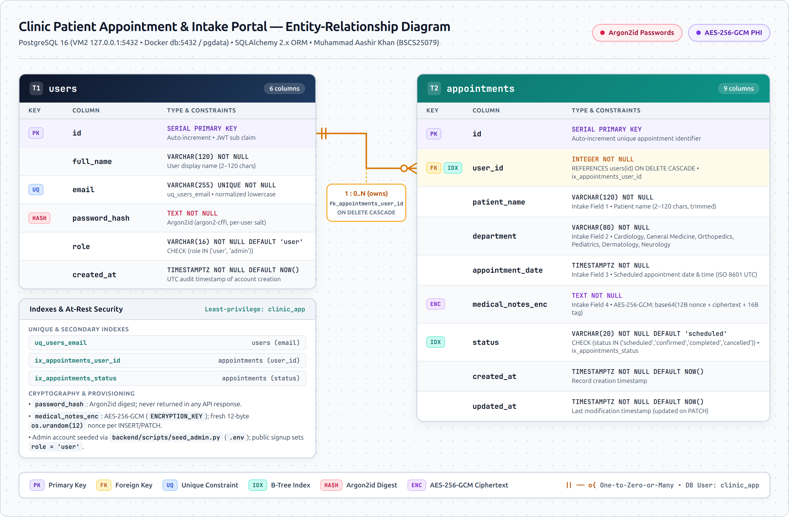

# Clinic Patient Appointment & Intake Portal

**Department of Computer Science — ITU | Data Communication & Computer Networks Lab (Project 01)**  
Secure Full-Stack Deployment, Network Analysis & Troubleshooting

---

## Team & Network Identity

| Role | Roll Number | Name | Primary Ownership |
| :--- | :---: | :--- | :--- |
| **Partner A** *(lower roll no.)* | `BSCS25067` | **Abdullah Saeed** | Frontend (React + Vite), VM1 (`bscs25067-web`), Nginx/TLS/Rate-Limit, VM3 Nginx & Docker Inspection, Bonus (Nginx/ModSecurity side) |
| **Partner B** *(higher roll no.)* | `BSCS25079` | **Muhammad Aashir Khan** | Backend (FastAPI + Crypto/Auth), PostgreSQL, VM2 (`bscs25067-api`), Dockerfile & Docker Compose, Bonus (Uvicorn TLS/Testing side) |

- **Lab Subnet (`XX = 67`):** `192.168.67.0/24` *(Host PC: `.1`, VM1: `.10`, VM2: `.20`, VM3: `.30`)*
- **Tech Stack:** React + Vite • FastAPI + Uvicorn + SQLAlchemy 2.x • PostgreSQL 16 • Nginx • Ubuntu Server LTS • Docker Engine
- **Submission Files:** `Project01_BSCS25067_BSCS25079.pdf` & `Project01_BSCS25067_BSCS25079.zip`

---

## Documentation Index

All project specifications, architecture diagrams, database references, API contracts, and progress trackers live in [`docs/`](./docs/):

| Document | Purpose |
| :--- | :--- |
| [docs/PRD.md](./docs/PRD.md) | Product requirements, user roles, 4-field intake form rules, required pages, security requirements, and acceptance criteria |
| [docs/design-doc.md](./docs/design-doc.md) | System architecture (Mermaid diagrams), VMware addressing, TLS/Nginx/UFW rules, Docker stack, and Bonus 1 & 2 designs |
| [docs/erd.png](./docs/erd.png) | PostgreSQL Entity-Relationship Diagram (`users` & `appointments` schema, keys, indexes, and encryption annotations) |
| [docs/Table.md](./docs/Table.md) | PostgreSQL schema reference, Mermaid ER diagram, constraints, AES-256-GCM packing format, and DDL |
| [docs/api-contract.md](./docs/api-contract.md) | Locked-in REST API contract (`/api/v1`), cookie/JWT defaults, error codes, JSON payloads, and `curl` test commands |
| [docs/checklist.md](./docs/checklist.md) | Phase-by-phase progress tracker for Abdullah & Aashir, Break-and-Fix fault log, submission audit, and viva readiness |

---

## Architecture Snapshot

- **Deployment 1 (Parts 2–4 — Two VMs on VMware Host-Only `192.168.67.0/24`):**
  - `bscs25067-web` (`192.168.67.10`): Nginx TLS 1.2/1.3 termination (`:443`), `:80 → 301` redirect, static React build (`/var/www/app`), login rate limit (`429`), ModSecurity + OWASP CRS (Bonus 2), proxies `/api/` to `api.lab.local:8000` (HTTP in Parts 2–4, verified HTTPS in Bonus 1).
  - `bscs25067-api` (`192.168.67.20`): FastAPI (`systemd` + Uvicorn on `:8000`) with Argon2id hashing, AES-256-GCM encrypted medical notes, `HttpOnly` JWT cookies, RBAC, and local-only PostgreSQL (`127.0.0.1:5432`).
- **Deployment 2 (Part 5 — Docker Engine on VM3):**
  - `bscs25067-docker` (`192.168.67.30`, UFW disabled): `web` (`nginx:stable`, `443:443` only) → `api` (custom Dockerfile, no published port) → `db` (`postgres:16-alpine` + `pgdata` volume, no published port) over isolated bridge network `lab-net`.

### Database ER Preview



---

## Non-Negotiable Ground Rules

1. **Hostnames visible in EVERY terminal screenshot** (`bscs25067-web`, `bscs25067-api`, `bscs25067-docker`).
2. **JWT in cookies ONLY** (`access_token` with `HttpOnly; Secure; SameSite=Lax` — never `localStorage` or `Authorization: Bearer`).
3. **PostgreSQL from Part 2 onward** (never SQLite on VM2 or Docker; VM2 PostgreSQL bound strictly to `127.0.0.1`).
4. **Zero real secrets in Git, ZIP, or PDF** (keep `.env`, `*.key`, `*.crt`, `node_modules/`, and `.venv/` excluded; commit `.env.example` placeholders only).
5. **One shared Git repo** with regular commits from both Abdullah and Aashir under their own Git accounts.
6. **Do NOT enable UFW on `bscs25067-docker`** (Docker `iptables` rules bypass UFW).
7. **Accurate `/api/v1/health` IP** (read `LAB_IP` from env or lab NIC — never `socket.gethostbyname(socket.gethostname())`).

---

## Planned Repository Structure

```text
CN-PROJECT-1/
├── docs/                  # PRD, Design Doc, ERD PNG/Tables, API Contract, Checklist
├── backend/               # FastAPI + SQLAlchemy + Crypto/Auth (Aashir — BSCS25079)
├── frontend/              # React + Vite SPA (Abdullah — BSCS25067)
├── infra/                 # Netplan, Nginx, systemd, and UFW configs (Joint)
├── docker-compose.yml     # VM3 Docker stack (lab-net, pgdata)
├── .env.example           # Sanitized environment template
├── .gitignore
└── README.md
```
