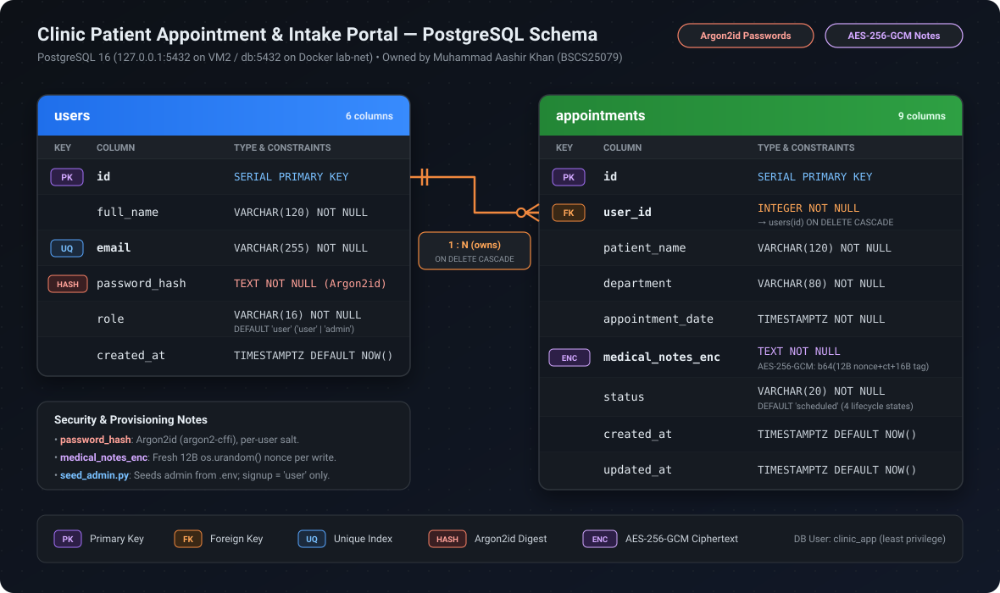

# Database Schema & Table Reference

**Engine:** PostgreSQL 16 (VM2 bound to `127.0.0.1:5432` only; VM3 Docker internal `db:5432` with named volume `pgdata`)  
**ORM:** SQLAlchemy 2.x (parameterized queries only — zero raw string-concatenated SQL)  
**Owner:** Muhammad Aashir Khan (`BSCS25079`)

---

## 1. Entity-Relationship Diagram



---

## 2. Table Definitions

### 2.1 Table: `users`

Stores registered patients (`user`) and seeded clinic staff (`admin`) credentials.

| Column | PostgreSQL Type | Nullable | Default | Constraints / Keys | Description |
| :--- | :--- | :---: | :--- | :--- | :--- |
| `id` | `SERIAL` | No | Auto-increment | `PRIMARY KEY` | Unique surrogate user identifier (`sub` in JWT). |
| `full_name` | `VARCHAR(120)` | No | — | — | User's display name (2–120 chars). |
| `email` | `VARCHAR(255)` | No | — | `UNIQUE` | Login identifier; normalized to lowercase before insert/lookup. |
| `password_hash` | `TEXT` | No | — | — | Argon2id password hash produced by `argon2-cffi` (`PasswordHasher()`). |
| `role` | `VARCHAR(16)` | No | `'user'` | `CHECK (role IN ('user', 'admin'))` | Authorization role (`'user'` or `'admin'`). |
| `created_at` | `TIMESTAMPTZ` | No | `NOW()` | — | UTC audit timestamp of account creation. |

> [!TIP]
> **Admin Provisioning:** Public registration (`POST /api/v1/auth/register`) always sets `role = 'user'`. Use `backend/scripts/seed_admin.py` (reading `ADMIN_EMAIL` and `ADMIN_PASSWORD` from `.env`) to idempotently create the `admin` account.

---

### 2.2 Table: `appointments`

Stores patient appointment intake submissions with encrypted medical notes.

| Column | PostgreSQL Type | Nullable | Default | Constraints / Keys | Description |
| :--- | :--- | :---: | :--- | :--- | :--- |
| `id` | `SERIAL` | No | Auto-increment | `PRIMARY KEY` | Unique appointment identifier. |
| `user_id` | `INTEGER` | No | — | `FOREIGN KEY → users(id) ON DELETE CASCADE`, Indexed | Owner account (patient who created the booking). |
| `patient_name` | `VARCHAR(120)` | No | — | — | **Form Field 1:** Patient's name for the intake record. |
| `department` | `VARCHAR(80)` | No | — | Enum validated in API | **Form Field 2:** Clinic department (`Cardiology`, `General Medicine`, `Orthopedics`, `Pediatrics`, `Dermatology`, `Neurology`). |
| `appointment_date` | `TIMESTAMPTZ` | No | — | — | **Form Field 3:** Scheduled appointment date & time (UTC / ISO 8601). |
| `medical_notes_enc` | `TEXT` | No | — | — | **Form Field 4 (Encrypted):** AES-256-GCM ciphertext encoded as `base64(12-byte nonce + ciphertext + 16-byte tag)`. |
| `status` | `VARCHAR(20)` | No | `'scheduled'` | `CHECK (status IN ('scheduled', 'confirmed', 'completed', 'cancelled'))` | Appointment lifecycle status. |
| `created_at` | `TIMESTAMPTZ` | No | `NOW()` | — | Record creation timestamp. |
| `updated_at` | `TIMESTAMPTZ` | No | `NOW()` | Updated on `PATCH` | Last modification timestamp. |

---

## 3. Relationships & Indexes

| Relationship / Index | Source | Target | Behavior |
| :--- | :--- | :--- | :--- |
| `fk_appointments_user_id` | `appointments.user_id` | `users.id` | **Many-to-One (`N : 1`)** with `ON DELETE CASCADE`. |
| `uq_users_email` | `users.email` | — | Enforces unique lowercased emails & accelerates login lookups. |
| `ix_appointments_user_id` | `appointments.user_id` | — | Accelerates `GET /api/v1/appointments` per-patient queries. |
| `ix_appointments_status` | `appointments.status` | — | Accelerates admin status filtering/review queries. |

---

## 4. Field-Level Cryptography & At-Rest Verification

Part 3 requires demonstrating that raw PostgreSQL rows never expose plaintext passwords or medical notes while the authenticated API returns decrypted `medical_notes`.

### 4.1 Raw Database Row vs. Decrypted API Output

| Field | Stored in PostgreSQL (Raw `psql` SELECT) | Returned by FastAPI JSON Response |
| :--- | :--- | :--- |
| `users.password_hash` | `$argon2id$v=19$m=65536,t=3,p=4$<salt>$<hash>` | *Never returned in any API response* |
| `appointments.medical_notes_enc` | `bX9p2kL0qR7vT4wZ...` *(base64 of 12B nonce + ciphertext + 16B GCM tag)* | `"medical_notes": "Persistent chest tightness after exercise"` |

### 4.2 AES-256-GCM Packing Format

```text
Raw bytes before base64:
┌──────────────────────┬──────────────────────────┬──────────────────────┐
│  Nonce (12 bytes)    │  Ciphertext (N bytes)    │  GCM Auth Tag (16 B) │
│  os.urandom(12)      │  AES-256-GCM encrypted   │  Integrity + Auth    │
└──────────────────────┴──────────────────────────┴──────────────────────┘
```

- A **fresh 12-byte nonce** is generated on every `POST /api/v1/appointments` and every `PATCH /api/v1/appointments/{id}` that updates `medical_notes`.
- Encryption key: 32-byte key stored base64-encoded in `ENCRYPTION_KEY` inside `.env`.

---

## 5. Reference PostgreSQL DDL

```sql
CREATE TABLE users (
    id            SERIAL PRIMARY KEY,
    full_name     VARCHAR(120) NOT NULL,
    email         VARCHAR(255) UNIQUE NOT NULL,
    password_hash TEXT NOT NULL,
    role          VARCHAR(16) NOT NULL DEFAULT 'user'
                  CHECK (role IN ('user', 'admin')),
    created_at    TIMESTAMPTZ NOT NULL DEFAULT NOW()
);

CREATE TABLE appointments (
    id                SERIAL PRIMARY KEY,
    user_id           INTEGER NOT NULL
                      REFERENCES users(id) ON DELETE CASCADE,
    patient_name      VARCHAR(120) NOT NULL,
    department        VARCHAR(80) NOT NULL,
    appointment_date  TIMESTAMPTZ NOT NULL,
    medical_notes_enc TEXT NOT NULL,
    status            VARCHAR(20) NOT NULL DEFAULT 'scheduled'
                      CHECK (status IN ('scheduled', 'confirmed', 'completed', 'cancelled')),
    created_at        TIMESTAMPTZ NOT NULL DEFAULT NOW(),
    updated_at        TIMESTAMPTZ NOT NULL DEFAULT NOW()
);

CREATE INDEX ix_appointments_user_id ON appointments (user_id);
CREATE INDEX ix_appointments_status ON appointments (status);
```
