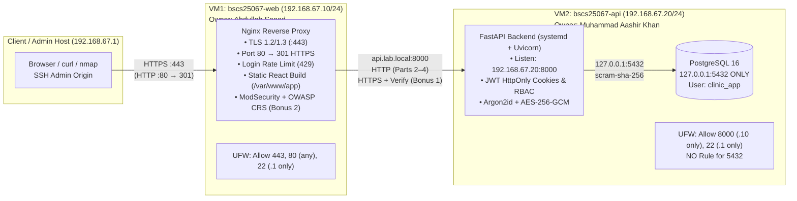
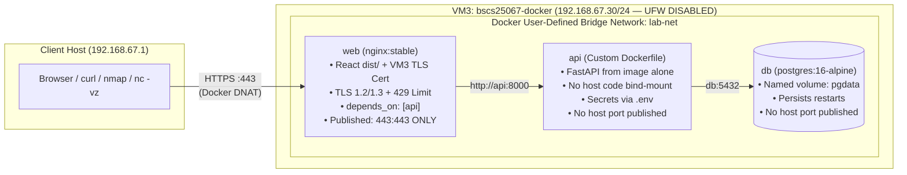

# Technical Design Document

**Project:** Clinic Patient Appointment & Intake Portal  
**Lab Subnet (`XX = 67`):** `192.168.67.0/24` (Network: `192.168.67.0`, Broadcast: `192.168.67.255`, Usable Hosts: `192.168.67.1 – 192.168.67.254`)  
**Stack:** React + Vite | FastAPI + Uvicorn + SQLAlchemy 2.x | PostgreSQL 16 | Nginx | Ubuntu Server 22.04/24.04 LTS | Docker Engine

> [!NOTE]
> If `192.168.67.0/24` overlaps your host's real network or VMware NAT (`ip route` on Linux / `route print` on Windows), replace `67 → 167` (`192.168.167.0/24`) consistently across all VMs and document the change in the final report.

---

## 1. System Architecture

### 1.1 Deployment 1 (Parts 2–4): Two-VM Architecture on VMware Host-Only Network



### 1.2 Deployment 2 (Part 5): Single-VM Containerized Stack on Docker



---

## 2. Network & Addressing Design

### 2.1 VMware Virtual Network Layout

1. **Host-Only Network (e.g., `vmnet1`):**
   - Subnet: `192.168.67.0`, Netmask: `255.255.255.0`.
   - **Disable** local DHCP service ("Use local DHCP service to distribute IP address to VMs" unticked).
   - Host adapter IP: `192.168.67.1`.
2. **NAT Network (e.g., `vmnet8`):**
   - Must use a **different** subnet (not `192.168.67.0/24`).
3. **VM NIC Attachment (every Ubuntu Server 22.04/24.04 LTS VM):**
   - **Adapter 1 (NAT):** DHCP — internet access for `apt` / `pip` / `docker` installs + default route.
   - **Adapter 2 (Host-Only):** Static IP configured via Netplan with **no gateway (on-link)**.

### 2.2 Addressing Plan

| Machine | Hostname | Static IP / Mask | Gateway (Lab NIC) | RAM / vCPU | Primary Owner |
| :--- | :--- | :--- | :--- | :--- | :--- |
| Host PC | *(Client / Admin)* | `192.168.67.1/24` | — | — | Both |
| VM1 | `bscs25067-web` | `192.168.67.10/24` | `none (on-link)` | 1 GB / 1–2 vCPU | Abdullah Saeed |
| VM2 | `bscs25067-api` | `192.168.67.20/24` | `none (on-link)` | 2 GB / 1–2 vCPU | Muhammad Aashir Khan |
| VM3 | `bscs25067-docker` | `192.168.67.30/24` | `none (on-link)` | 2 GB / 1–2 vCPU | Both |

### 2.3 Netplan & Name Resolution

- **Netplan:** Edit `/etc/netplan/*.yaml` (`sudo chmod 600`), validate with `sudo netplan try`, and apply via `sudo netplan apply`. If `cloud-init` resets networking on reboot, create `/etc/cloud/cloud.cfg.d/99-disable-network-config.cfg` with:
  ```yaml
  network: {config: disabled}
  ```
- **Local Name Resolution (VM1):** Add `192.168.67.20 api.lab.local` to `/etc/hosts`. Nginx **must** proxy `/api/` to `http://api.lab.local:8000` (never the raw IP).

---

## 3. Application & Security Design

### 3.1 Authentication & Encryption Flow

```mermaid
sequenceDiagram
    autonumber
    actor User as Patient / Admin Browser
    participant Nginx as VM1 Nginx (:443)
    participant API as VM2 FastAPI (:8000)
    participant DB as VM2 PostgreSQL (127.0.0.1:5432)

    User->>Nginx: POST /api/v1/auth/login (email, password)
    Note over Nginx: Rate limit check (5r/m, burst=3 nodelay → 429)
    Nginx->>API: Forward request + X-Forwarded-Proto: https
    API->>DB: SELECT user by lowercased email (SQLAlchemy ORM)
    DB-->>API: User row (Argon2id password_hash, role)
    API->>API: Verify password via argon2-cffi
    API->>API: Sign HS256 JWT {sub, role, iat, exp (+30m)}
    API-->>Nginx: 200 OK + Set-Cookie: access_token=...; HttpOnly; Secure; SameSite=Lax
    Nginx-->>User: 200 OK + Set-Cookie

    User->>Nginx: POST /api/v1/appointments (Cookie: access_token)
    Nginx->>API: Forward request with Cookie
    API->>API: Validate JWT cookie & Pydantic v2 schema
    API->>API: Generate os.urandom(12) nonce + AES-256-GCM encrypt medical_notes
    API->>DB: INSERT INTO appointments (..., medical_notes_enc)
    DB-->>API: Saved row
    API-->>Nginx: 201 Created (decrypted JSON envelope)
    Nginx-->>User: 201 Created
```

### 3.2 Backend Design (`backend/` — Owned by Aashir)

- **Framework & Server:** FastAPI running on Uvicorn via `systemd` (`clinic-api.service`), listening on `192.168.67.20:8000` with proxy header awareness:
  ```bash
  uvicorn app.main:app --host 192.168.67.20 --port 8000 \
    --proxy-headers --forwarded-allow-ips="192.168.67.10,172.16.0.0/12"
  ```
- **Password Hashing (`security.py`):** `argon2-cffi` `PasswordHasher()` (Argon2id with automatic per-user salt).
- **Field Encryption at Rest (`security.py`):**
  - Primitive: `cryptography.hazmat.primitives.ciphers.aead.AESGCM` with a 32-byte key decoded from base64 `ENCRYPTION_KEY` in `.env`.
  - Format: `base64(nonce[12] || ciphertext || tag[16])`.
  - Fresh `os.urandom(12)` nonce generated on **every** `INSERT` and `UPDATE` (never reused).
- **JWT Sessions (`security.py` & `deps.py`):**
  - Signed with `HS256` using `JWT_SECRET` from `.env`, expiry = `30` minutes (`1800` seconds).
  - Payload: `{ "sub": "<user_id>", "role": "user|admin", "iat": <unix>, "exp": <unix> }`.
  - Delivered via `Set-Cookie: access_token=<jwt>; HttpOnly; Secure; SameSite=Lax; Path=/; Max-Age=1800`.
  - FastAPI dependencies enforce `401 Unauthorized` (missing/expired/invalid JWT) and `403 Forbidden` (insufficient role or non-owner access).
- **Database Access (`database.py`, `models.py`):**
  - SQLAlchemy 2.x ORM only — zero raw string-concatenated SQL.
  - PostgreSQL configured with `listen_addresses = 'localhost'` (`postgresql.conf`) and `scram-sha-256` for `127.0.0.1/32` (`pg_hba.conf`), accessed by dedicated least-privilege DB user `clinic_app`.
- **Health Endpoint (`routers/health.py`):**
  - Reads `LAB_IP` from `.env` (or inspects the lab interface) — never calls `socket.gethostbyname(socket.gethostname())`.
  - Executes a lightweight `SELECT 1` check to report `db_reachable: true|false` (returning `200` when reachable, `500` when unreachable).
- **Global Error Handling (`main.py`):**
  - Custom exception handlers convert Pydantic `RequestValidationError` (`422` → `400`), `HTTPException`, and unhandled `500` errors into the unified JSON error envelope `{ "status": "error", "error": { "code": "...", "message": "..." } }`.
- **Admin Seeding (`scripts/seed_admin.py`):**
  - Idempotent CLI script reading `ADMIN_EMAIL` and `ADMIN_PASSWORD` from `.env` to provision the clinic staff `admin` account without exposing role escalation in public registration.

### 3.3 Frontend Design (`frontend/` — Owned by Abdullah)

- **Framework:** React + Vite SPA compiled via `npm run build` and deployed to `/var/www/app/` on VM1 (and copied into `web` container image/mount on VM3).
- **API Client (`src/api/client.js`):**
  - Uses relative URLs (`/api/v1/...`) with `fetch(..., { credentials: "include" })`.
  - Same-origin behind Nginx means **no CORS headers required**, zero secrets in frontend code, and zero client-side cryptography.
  - Defensively checks `res.status` and the `Content-Type` header before calling `res.json()` so any non-JSON HTML error page returned by Nginx (`429`) or ModSecurity (`403`) is handled gracefully without throwing a JSON parse `SyntaxError`.
- **Auth State (`src/context/AuthContext.jsx`):**
  - Hydrates `{ id, full_name, email, role }` on application boot via `GET /api/v1/auth/me`.
  - Never touches `localStorage` or `sessionStorage` for tokens.
- **Routing (`src/App.jsx`):**
  - Routes: `/register`, `/login`, `/change-password`, `/appointments`, `/admin`.
  - Protected routes redirect unauthenticated users to `/login`; `/admin` hides staff UI for `user` accounts while relying on backend `403` enforcement.

---

## 4. Nginx, TLS & Firewall Design (Parts 3–4)

### 4.1 VM1 Nginx & TLS Configuration (`infra/nginx/vm1-lab.conf`)

- **Self-Signed Certificate:** `/etc/ssl/lab/web.crt` & `/etc/ssl/lab/web.key` (`chmod 600`):
  - `CN=bscs25067-web`
  - `SAN=DNS:bscs25067-web,IP:192.168.67.10`
- **TLS Settings:** `ssl_protocols TLSv1.2 TLSv1.3;` on port `443`; port `80` returns `301 https://$host$request_uri;`.
- **Login Rate Limiting:**
  ```nginx
  limit_req_zone $binary_remote_addr zone=login:10m rate=5r/m;

  location = /api/v1/auth/login {
      limit_req zone=login burst=3 nodelay;
      limit_req_status 429;
      error_page 429 = @rate_limited;
      proxy_pass http://api.lab.local:8000;
      proxy_set_header Host $host;
      proxy_set_header X-Real-IP $remote_addr;
      proxy_set_header X-Forwarded-For $proxy_add_x_forwarded_for;
      proxy_set_header X-Forwarded-Proto $scheme;
  }

  location @rate_limited {
      default_type application/json;
      return 429 '{"status":"error","error":{"code":"RATE_LIMITED","message":"Too many login attempts. Please try again later."}}';
  }
  ```
- **General API & SPA Routing:**
  - `/api/` proxies to `http://api.lab.local:8000` with `X-Forwarded-Proto $scheme`.
  - `/` serves `/var/www/app/` with `try_files $uri $uri/ /index.html;` for React Router history fallback.

### 4.2 UFW Firewall Rules (Part 4)

> [!WARNING]
> Always add the SSH allow rule **before** running `sudo ufw enable` to avoid locking yourself out.

| Host | Default Policy | Allowed Incoming Rules | Explicitly Blocked / Unexposed |
| :--- | :--- | :--- | :--- |
| **VM1 (`bscs25067-web`)** | `deny incoming`, `allow outgoing` | `22/tcp` from `192.168.67.1` • `443/tcp` anywhere • `80/tcp` anywhere | `8000/tcp`, `5432/tcp`, SSH from any non-admin IP |
| **VM2 (`bscs25067-api`)** | `deny incoming`, `allow outgoing` | `22/tcp` from `192.168.67.1` • `8000/tcp` from `192.168.67.10` only | `5432/tcp` (no rule + bound to `127.0.0.1`), `80/tcp`, `443/tcp`, `8000/tcp` from `.1` or `.30` |
| **VM3 (`bscs25067-docker`)** | **UFW DISABLED** | Container port publishing controls exposure (`443:443` only) | `api:8000` and `db:5432` have zero published host ports |

Verification command (run before and after UFW from Host PC `.1` and from VM3 `.30` to prove port `22` is filtered for non-admin hosts):
```bash
nmap -Pn -p 22,80,443,8000,5432 192.168.67.10
nmap -Pn -p 22,80,443,8000,5432 192.168.67.20
```

---

## 5. Docker Deployment Design (Part 5 — VM3)

Runs on `bscs25067-docker` (`192.168.67.30`, UFW disabled) via `docker-compose.yml`:

| Service | Image / Build | Ports Published | Network / Storage | Owner |
| :--- | :--- | :--- | :--- | :--- |
| `web` | `nginx:stable` | `443:443` only | `lab-net`, mounts compiled `dist/`, VM3 cert (`CN=bscs25067-docker`, `SAN=DNS:bscs25067-docker,IP:192.168.67.30`), `depends_on: [api]` | Abdullah |
| `api` | Custom `./backend/Dockerfile` | None | `lab-net`, built image only (no host code bind-mount), connects to `db:5432`, secrets via `.env` | Aashir |
| `db` | `postgres:16-alpine` | None | `lab-net`, persistent named volume `pgdata:/var/lib/postgresql/data` | Aashir |

- **Bridge Network:** Fixed name `name: lab-net` so `docker network inspect lab-net` works predictably.
- **Required Inspection Captures:** `docker network ls`, `docker network inspect lab-net`, `docker exec <web> getent hosts api`, `docker exec <web> getent hosts db`, `ip addr show`, `sudo iptables -t nat -L -n -v`, and `nc -vz` / `nmap` port-isolation proofs.

---

## 6. Bonus Architecture Designs (After Parts 2–4 Are Captured)

> [!IMPORTANT]
> **Critical Sequencing:** Complete and screenshot **all** of Parts 2, 3, and 4 while VM1 → VM2 is still plain HTTP. Only then apply Bonus 1 and Bonus 2.

### 6.1 Bonus 1: End-to-End TLS on VM1 → VM2 Hop

1. **Before Capture (Aashir on VM2):** `sudo tcpdump -i <lab-iface> -A -s 0 port 8000` while Abdullah hits `https://192.168.67.10/api/v1/health` — capture readable plaintext HTTP headers & JSON.
2. **Backend TLS (Aashir on VM2):**
   - Generate `/etc/ssl/lab/api.key` (`chmod 600`) & `/etc/ssl/lab/api.crt` with `CN=api.lab.local`, `SAN=DNS:api.lab.local,IP:192.168.67.20`.
   - Update `clinic-api.service` Uvicorn flags: `--ssl-keyfile /etc/ssl/lab/api.key --ssl-certfile /etc/ssl/lab/api.crt`.
3. **Verified Upstream Proxy (Abdullah on VM1):**
   - Copy `/etc/ssl/lab/api.crt` from VM2 to VM1 (`/etc/ssl/lab/api.crt`).
   - Update `proxy_pass` to `https://api.lab.local:8000;` with:
     ```nginx
     proxy_ssl_trusted_certificate /etc/ssl/lab/api.crt;
     proxy_ssl_verify on;
     proxy_ssl_verify_depth 1;
     proxy_ssl_server_name on;
     proxy_ssl_protocols TLSv1.2 TLSv1.3;
     ```
4. **After Capture (Both):** Re-run the exact `tcpdump` capture on VM2 and screenshot encrypted TLS application frames.

### 6.2 Bonus 2: ModSecurity + OWASP Core Rule Set (CRS) on VM1

1. **Install & Enable (Abdullah on VM1):** Install `libmodsecurity3` + `libnginx-mod-http-modsecurity` (Ubuntu 24.04, or build connector for Ubuntu 22.04), enable `modsecurity on;` in `/etc/nginx/sites-available/lab`, set `SecRuleEngine On` in `/etc/nginx/modsec/modsecurity.conf`, and include OWASP CRS (`crs-setup.conf` + `rules/*.conf`).
2. **Verification (Aashir from Client + Abdullah on VM1 logs):**
   ```bash
   curl -vk "https://192.168.67.10/api/v1/appointments?q=%27%20OR%201%3D1%20--"
   ```
   Capture the `403 Forbidden` response from Nginx alongside the matching ModSecurity audit/error log entry showing the triggered OWASP CRS rule ID.

---

## 7. Planned Repository Layout

```text
CN-PROJECT-1/
├── docs/                          # PRD, Design Doc, Schema SVG/Tables, API Contract, Checklist
├── backend/                       # Owned by Aashir (BSCS25079)
│   ├── app/
│   │   ├── main.py                # FastAPI app, global JSON error handlers
│   │   ├── config.py              # Pydantic Settings env var loading
│   │   ├── database.py            # SQLAlchemy 2.x engine & session
│   │   ├── models.py              # User & Appointment ORM models
│   │   ├── schemas.py             # Pydantic v2 validation schemas
│   │   ├── security.py            # Argon2id, AES-256-GCM, JWT cookie helpers
│   │   ├── deps.py                # Auth & admin RBAC dependencies
│   │   └── routers/
│   │       ├── health.py          # GET /api/v1/health
│   │       ├── auth.py            # register, login, logout, me, change-password
│   │       ├── appointments.py    # patient appointment CRUD
│   │       └── admin.py           # admin-only endpoints
│   ├── scripts/seed_admin.py      # Seeds admin account from .env
│   ├── requirements.txt
│   ├── Dockerfile
│   └── .env.example               # Placeholders only
├── frontend/                      # Owned by Abdullah (BSCS25067)
│   ├── src/
│   │   ├── api/client.js          # fetch wrapper with credentials: "include"
│   │   ├── context/AuthContext.jsx
│   │   ├── pages/                 # Login, Register, ChangePassword, Appointments, Admin
│   │   └── App.jsx
│   ├── package.json
│   └── vite.config.js
├── infra/                         # Jointly maintained
│   ├── netplan/                   # Sanitized Netplan configs (VM1, VM2, VM3)
│   ├── nginx/
│   │   ├── vm1-lab.conf           # VM1 Nginx (TLS + 429 + HTTP proxy)
│   │   ├── vm1-lab-bonus.conf     # VM1 Nginx (+ HTTPS proxy_pass + ModSecurity)
│   │   └── docker-nginx.conf      # VM3 Docker Nginx (proxies to api:8000)
│   ├── systemd/clinic-api.service
│   └── ufw/                       # Saved ufw status outputs (VM1 & VM2)
├── docker-compose.yml
├── .env.example
├── .gitignore
└── README.md
```
